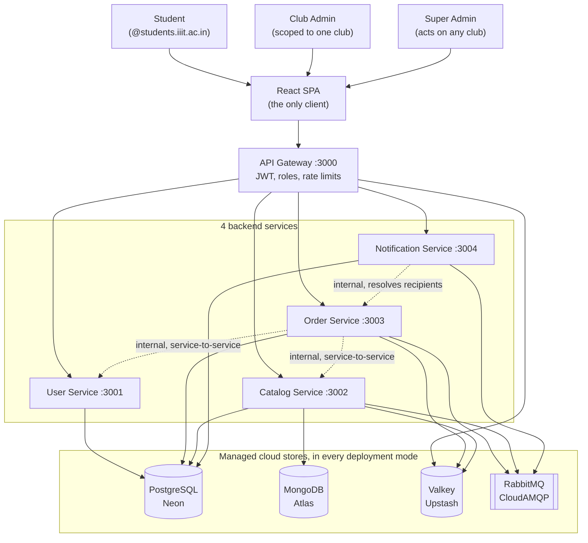

# System Context

Three actors, one entry point. Every browser request, whatever the role, goes through the API Gateway. The frontend never calls a backend service directly.

A few things this diagram is deliberately explicit about, because they're easy to get wrong when explaining the system out loud:

- **The three roles are one `users` table, not three systems.**
  - `role` is just a column (`STUDENT` / `CLUB_ADMIN` / `SUPER_ADMIN`).
  - The gateway enforces which roles may use a route (`services/api-gateway/middleware/rbacMiddleware.js`), and the owning service checks club ownership.
  - There's no separate admin backend.
- **Order Service talks to User Service and Catalog Service directly**, bypassing the gateway, and authenticates with the shared `X-Internal-Service-Key` header instead of a JWT. This is a deliberate trust boundary; see [jwt-and-rbac.md](../LLD/auth-and-access-control/jwt-and-rbac.md) for why it's safe.
- **Notification Service calls back into Order Service** (`GET /by-item/:catalogItemId/users`) to find out who should be notified about a delivery-slot change. The alternative was to make Order Service a second RabbitMQ publisher/subscriber pair just to answer this one question. The direct call keeps Order Service's only RabbitMQ role as publishing its two order events. The "Why HTTP, not a second RabbitMQ hop" section of [strategy-observer-pattern.md](../LLD/design-patterns/strategy-observer-pattern.md) explains the choice.
- **Two less obvious store connections:**
  - Catalog Service uses Postgres only to check that a club id exists when a Super Admin publishes an item for a named club.
  - The gateway uses Valkey for rate limiting.
- **Every store is a managed cloud service, reached over the public internet**, whether the services run as local processes, Docker Compose containers, or Render web services. On Render, every backend service also has its own public URL, guarded by the internal key. See [04-deployment.md](04-deployment.md).
