# Service Architecture

This diagram is drawn from the gateway's actual route table in `services/api-gateway/index.js`, the source of truth for exact routes and ports.

```mermaid
flowchart LR
    Client(["Browser / Frontend"])

    subgraph GW["API Gateway :3000"]
        direction TB
        Own["Own routes:\nGET /health\nGET /api/v1/warmup"]
        Auth["authMiddleware\n(JWT verify)"]
        RL["catalogRateLimiter / ordersRateLimiter\n(catalog + orders only)"]
        RBAC["requireRoles (scoped routes)\ninjectClubId (catalog + orders)"]
        Proxy["http-proxy-middleware\n+ X-Internal-Service-Key on every request"]
    end

    Client --> Auth --> RL --> RBAC --> Proxy
    Client --> Own

    Proxy -->|"/api/v1/users/*\n(PUT /:userId/role and GET /lookup routed first)"| US["User Service :3001\nPostgreSQL: users, clubs"]
    Proxy -->|"/api/v1/clubs/*"| US
    Proxy -->|"/api/v1/catalog/*"| CS["Catalog Service :3002\nMongoDB: items, reservations, compensations\nValkey: feed cache\nPostgreSQL: club-id check"]
    Proxy -->|"/api/v1/orders/*"| OS["Order Service :3003\nPostgreSQL: orders\nValkey: locks + idempotency"]
    Proxy -->|"/api/v1/notifications/*"| NS["Notification Service :3004\nPostgreSQL: notifications"]

    OS -.->|"internal: fetch profile (preferred size)"| US
    OS -.->|"internal: read item, reserve / commit / rollback stock"| CS
    OS -->|"publish order.placed / order.delivered"| MQ[["RabbitMQ\nexchange: order.events (topic)"]]
    CS -->|"publish delivery.slot.updated"| MQ
    MQ -->|"consume all 3 routing keys\n(one durable queue: notification_queue)"| NS
    NS -.->|"internal: GET /by-item/:id/users"| OS
```

The middleware chain differs per prefix; the diagram shows the superset.

| Prefix | Chain in the gateway |
|---|---|
| `/api/v1/catalog` | JWT, then rate limiter, then `CLUB_ADMIN` check on create / delivery-slot only, then `injectClubId`, then proxy |
| `/api/v1/orders` | JWT, then rate limiter, then `CLUB_ADMIN` check on `GET /club` / `PATCH /:orderId/status` only, then `injectClubId`, then proxy |
| `/api/v1/clubs` | JWT, then `SUPER_ADMIN` check on `POST /` only, then proxy |
| `/api/v1/users` | JWT on the profile routes only, then proxy |
| `/api/v1/notifications` | JWT, then proxy |

In each role check, `SUPER_ADMIN` always passes.

Three routing details worth knowing cold, because they sound like bugs until you see the reasoning:

1. **`PUT /api/v1/users/:userId/role` and `GET /api/v1/users/lookup` are registered *before* the general `/api/v1/users` proxy.**
   - They're exact-path `app.put()` / `app.get()` routes, each with its own `pathRewrite`.
   - Express matches in registration order. If the general `app.use('/api/v1/users', …)` proxy came first, it would swallow both routes before their `SUPER_ADMIN`-only checks ran.
2. **`/register` and `/login` are deliberately left out of the auth-required list** (`PROFILE_ACCESS_ROUTES` in `index.js`), because there's no JWT yet when someone is trying to log in. Auth on this prefix covers exactly `PUT /profile`, `PUT /size` and `GET /profile/:userId`.
3. **Order Service and Notification Service make internal HTTP calls that skip the gateway entirely.**
   - They authenticate with the same `X-Internal-Service-Key` the gateway attaches, not a JWT.
   - A JWT represents *a user's* identity, and these calls aren't made on behalf of a user in the same way.
   - See [jwt-and-rbac.md](../LLD/auth-and-access-control/jwt-and-rbac.md).

For the store choices themselves (why Postgres for orders and users, why Mongo for the catalog, why Valkey does two unrelated jobs) see [polyglot-persistence.md](../LLD/data-modeling/polyglot-persistence.md). This file is about routing and ownership, not the "why" of each store.
