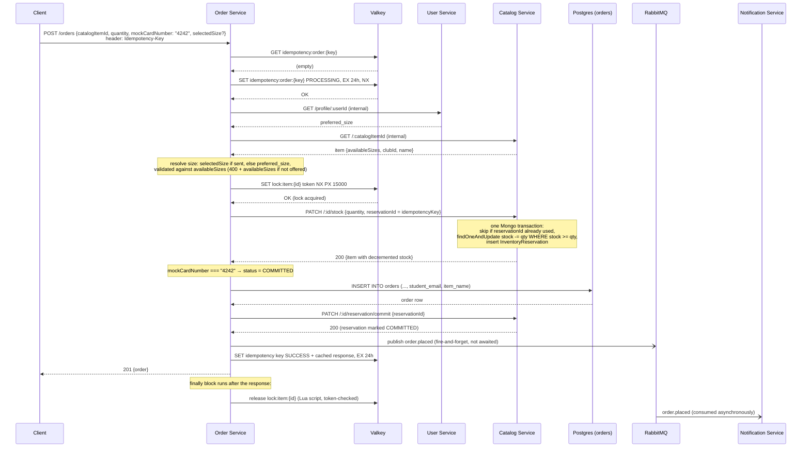
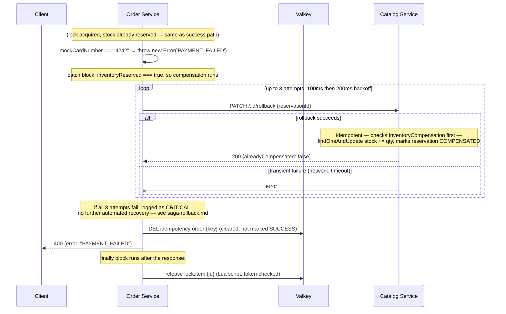

# Request Lifecycle: Checkout

This is the most interview-relevant diagram in the repo. It's the one flow that touches almost every distributed-systems mechanism in the project in a single request: idempotency, the lock, the saga, three services, and one message broker. It's built directly from `services/order-service/routes/orders.js`, `POST /` (L77-L495); line references point there unless noted.

The client reaches Order Service through the gateway, which first verifies the JWT, applies the orders rate limiter, and attaches the internal key. Those gateway steps are left out of the diagrams below.

## The success path (`mockCardNumber: "4242"`)

## The failure path (`mockCardNumber` anything other than `"4242"`, e.g. `"4000"` or blank)

Everything up to the stock reservation is identical. The paths diverge right after `PATCH /:id/stock` succeeds. The code deliberately reserves stock *before* evaluating payment, which is exactly what makes a compensating transaction necessary.

## The other early exits

| Where | Response | What else happens |
|---|---|---|
| No `Idempotency-Key` header | `400` | Nothing touched |
| Key already `SUCCESS` | `200` + the cached response | No new order |
| Key still `PROCESSING` (a duplicate in flight) | `409` | Nothing touched |
| Valkey unreachable during the idempotency check | `503` | Nothing touched |
| Size not offered / no preferred size saved | `400` + `availableSizes` | Idempotency key cleared |
| Lock held by another checkout | `409 LOCK_CONTENTION_DETECTED`, `Retry-After: 1` | Idempotency key cleared. The frontend retries with the same key. |
| Not enough stock | `409 OUT_OF_STOCK` | Nothing was reserved, so there's no compensation. Key cleared, lock released. |

Three things about this flow that are easy to get wrong when explaining it from memory:

- **The lock is released in a `finally` block** (L486-L493). It runs whether the request succeeds, fails at payment, or fails at any earlier step after the lock was taken. There's exactly one place the lock is released, not one per exit path. Because `return res…` executes before `finally`, the client gets its response slightly before the lock is released.
- **Idempotency and locking solve different problems, at different points.**
  - The idempotency check happens *before* the lock is even attempted, so a retried request with the same key never re-enters the flow.
  - The lock is scoped to the *item*, not the request. Two students checking out the same item both pass the idempotency check (their keys differ), but only one gets the lock.
  - See [idempotency.md](../LLD/concurrency-control/idempotency.md) for the sharp version of this distinction.
- **A failed compensation doesn't roll anything back further.** If all 3 rollback attempts fail, the code logs `CRITICAL` and returns `400` anyway. The student correctly sees "payment failed", but the stock count is understated until someone intervenes manually. This is an acknowledged gap, not a hidden one; see [saga-rollback.md](../LLD/saga-and-compensation/saga-rollback.md).
