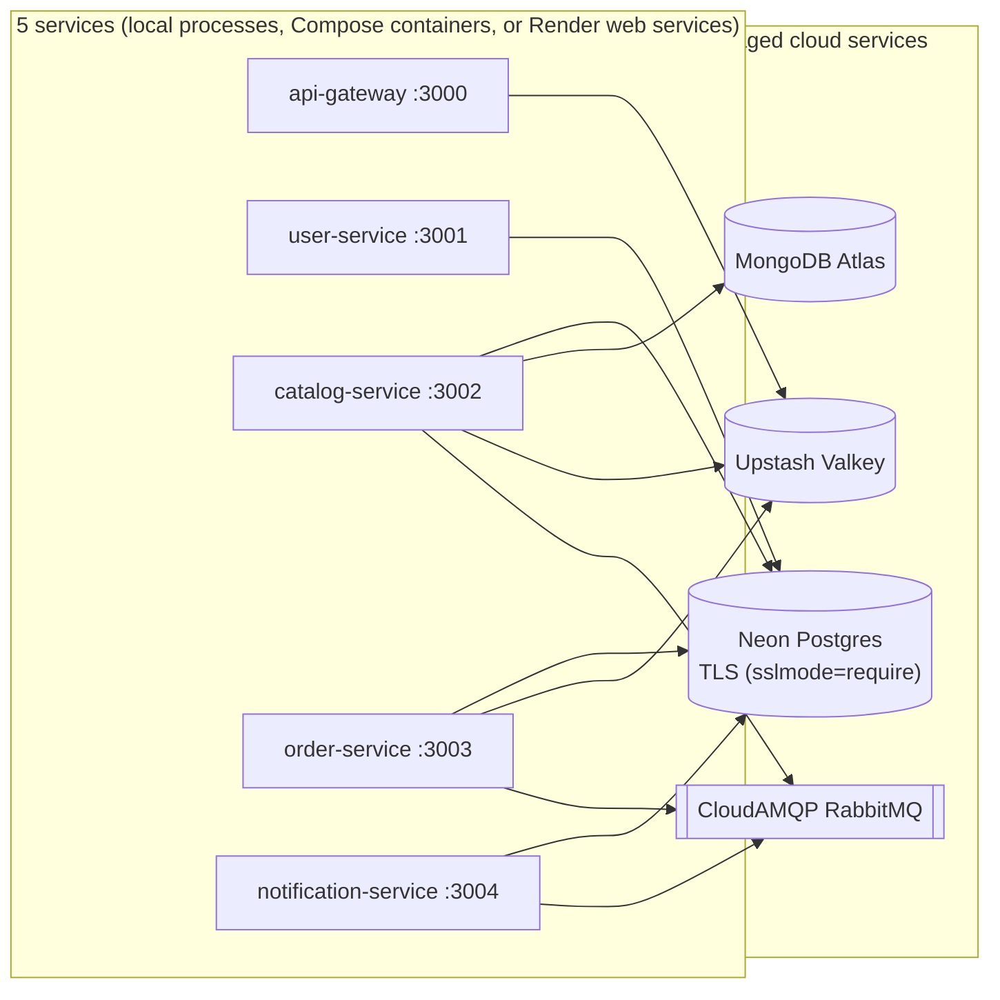
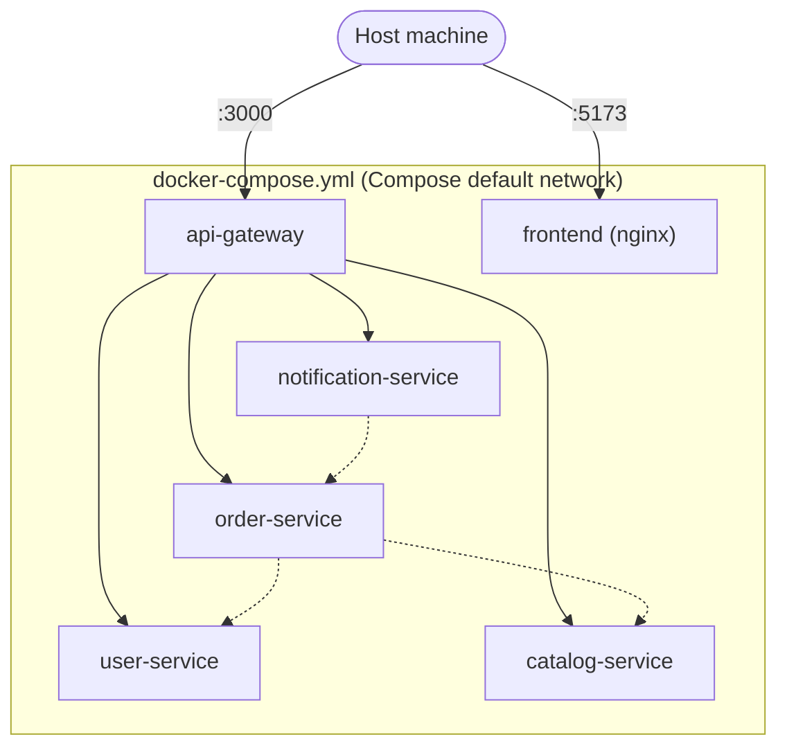

# Deployment

The system runs in three ways. The application code is the same in all three, and so are the data stores: managed cloud services in every mode. What changes is how the services are started and how they find each other.

| Mode | How services run | How they find each other | What's exposed |
|---|---|---|---|
| **Local, plain Node** (`npm run dev`) | 5 `node` processes on one machine (npm workspaces + `concurrently`) | `http://localhost:3001`–`3004` (the default in each `*_SERVICE_URL`) | Every port, on localhost |
| **Local, Docker Compose** (`docker compose up --build`) | 6 containers: 5 services + the frontend behind nginx | Compose DNS names (`http://user-service:3001`, …), set through env vars in `docker-compose.yml` | Only the gateway (`3000`) and the frontend (`5173`) are published to the host |
| **Deployed, Render free tier** (`render.yaml`) | 5 Docker web services + the frontend as a static site | Each service's public `https://…onrender.com` URL, set by hand in the dashboard | **Every service has a public URL** |

## The data stores are the same in every mode

* **No containers for the stores:** no Postgres, Mongo, Valkey or RabbitMQ container exists in any mode, including Docker Compose.
* **What each service uses:**
  * **Postgres:** User, Order and Notification Service share one Neon instance. Catalog Service uses it only to validate a club id when a Super Admin publishes an item.
  * **Valkey:** the gateway uses it for rate limiting.
* **Why latency is high:** every call to a store crosses the public internet. That's why the measured cache numbers in [catalog-feed-cache.md](../LLD/caching/catalog-feed-cache.md) (≈207 ms hit vs ≈336 ms miss) are dominated by network round-trips, not by the cache lookup itself.

## Local: plain Node processes

* **Purpose:** the fastest loop while changing code.
* **How:** `npm run dev` at the repo root starts all five backend services, and `cd frontend && npm run dev` starts the frontend on `:5173`.
* **Configuration:** services read the repo-root `.env`. With no `*_SERVICE_URL` overrides, they call each other on `localhost`.
* **Isolation:** none at the network level. Anyone on the machine can reach `:3001`–`:3004` directly, so the `X-Internal-Service-Key` check in each service's `internalAuthMiddleware` is what stops direct calls.

## Local: Docker Compose

* **Images:** every service builds from its own `Dockerfile`. The frontend is built with `VITE_API_BASE_URL=http://localhost:3000/api/v1` and served by nginx.
* **Exposed ports:** only the gateway and the frontend are published to the host. The other four services are reachable only inside the Compose network, by service name.
* **No code changes between modes:** each `*_SERVICE_URL` defaults to `localhost`, and `docker-compose.yml` overrides it with the Compose hostname.
* **Configuration:** all containers read the same repo-root `.env` (`env_file: .env`).

## Deployed: Render free tier

* **What gets deployed:** `render.yaml` deploys the five backend services from their Dockerfiles, and the frontend as a static site, all on `plan: free`.
* **The constraint that shapes it:** on Render's free tier a web service can *send* private-network requests but can't *receive* them, and Private Services have no free tier at all.
  * Every backend service therefore has a **public HTTPS URL**, and inter-service calls go over the public internet.
  * The `X-Internal-Service-Key` check is the security boundary. It never depended on which network a request arrived over.
  * Each `*_SERVICE_URL` is filled in by hand after the first deploy, because the URLs aren't known until each service exists.
* **Idle sleep:** free services go to sleep when idle, and the system handles this at both ends.
  * **Frontend:** on load it calls the gateway's `GET /api/v1/warmup`, so every backend service starts waking at the same time. If a replay-safe request fails while a service is still waking, the frontend waits 30 seconds and retries (at most twice), showing a "waking up" banner meanwhile.
  * **Gateway:** `/api/v1/warmup` pings each service's `/health` with the internal key and answers `202` immediately, without waiting for the pings.
* **Secrets:** they live in the Render dashboard (`sync: false`), not in `render.yaml`.

## What this means for the security model

* **No mode isolates the services by network alone.**
  * In local Node mode, every port is open on the machine.
  * In Render mode, every service is public.
  * Only Compose hides the four backend services behind the gateway, and even there the internal key is still checked.
* **The internal key is the boundary in every mode.** That's why every backend service enforces it globally, on every route including `/health`.
* See [SECURITY_AND_ACCESS.md](../../SECURITY_AND_ACCESS.md) §4.
